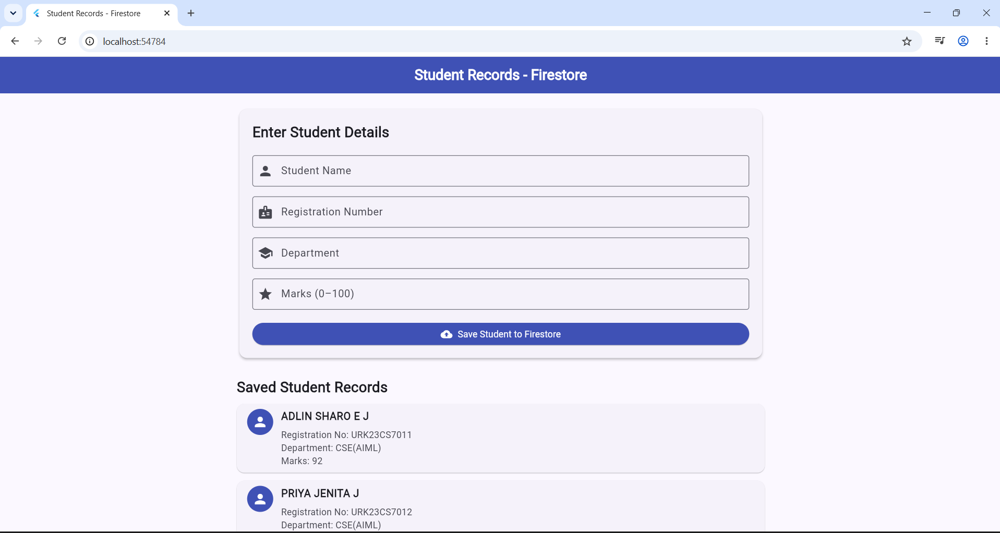
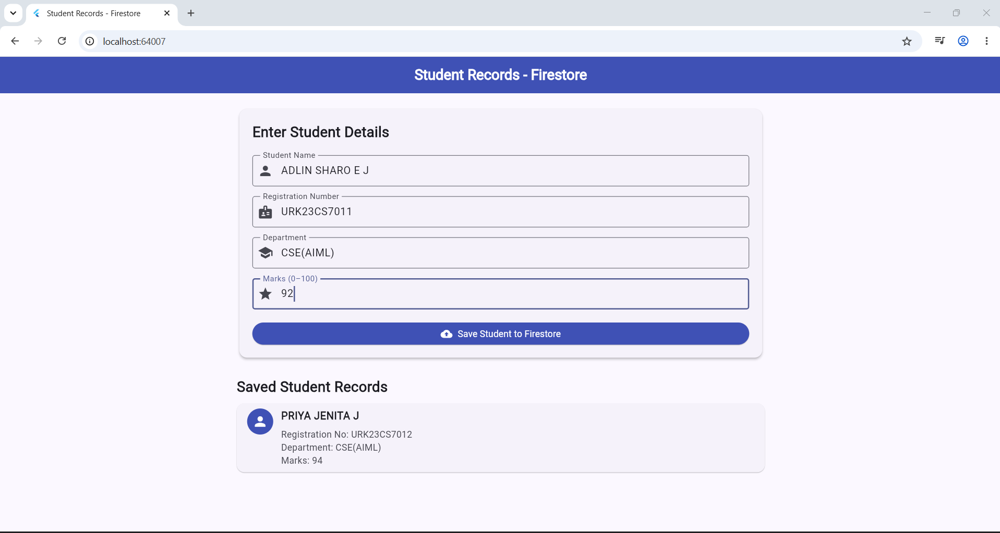
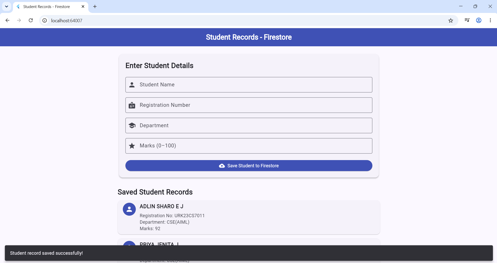

# Experiment 7 – Data Persistence Using Google Cloud Firestore

## Aim
To develop a Flutter application that stores and retrieves student records using Google Cloud Firestore.

## Description
This experiment demonstrates cloud-based data persistence using Flutter and Firebase Cloud Firestore. The application allows users to enter student details, save them to the cloud database, and retrieve and display the stored records.

## Technologies Used
- Flutter
- Dart
- Firebase Core
- Cloud Firestore
- Visual Studio Code

## Features
- Enter student details.
- Store records in Google Cloud Firestore.
- Retrieve saved student records.
- Display student records in the application.
- Use the registration number as the document ID.
- Automatically update the displayed records using Firestore streams.

## Database Structure
**Collection Name:** `students`

**Document ID:** Student Registration Number

**Fields:**
- `name`
- `registrationNumber`
- `department`
- `marks`
- `createdAt`

## Sample Input

| Field | Value |
|---|---|
| Name | PRIYA JENITA J |
| Registration Number | URK23CS7012 |
| Department | CSE(AIML) |
| Marks | 94 |

## Procedure
1. Create a Flutter application.
2. Create a project in the Firebase Console.
3. Configure Firebase using FlutterFire CLI.
4. Add the `firebase_core` and `cloud_firestore` dependencies.
5. Initialize Firebase in the Flutter application.
6. Design a form to enter student details.
7. Save student records to the Firestore database.
8. Retrieve and display the saved records.
9. Run and test the application.

## Output Screenshots

### 1. Initial Application Screen

### 2. Student Details Entry

### 3. Record Saved Successfully

## Result
Thus, the Flutter application was developed successfully to store and retrieve student records using Google Cloud Firestore.
